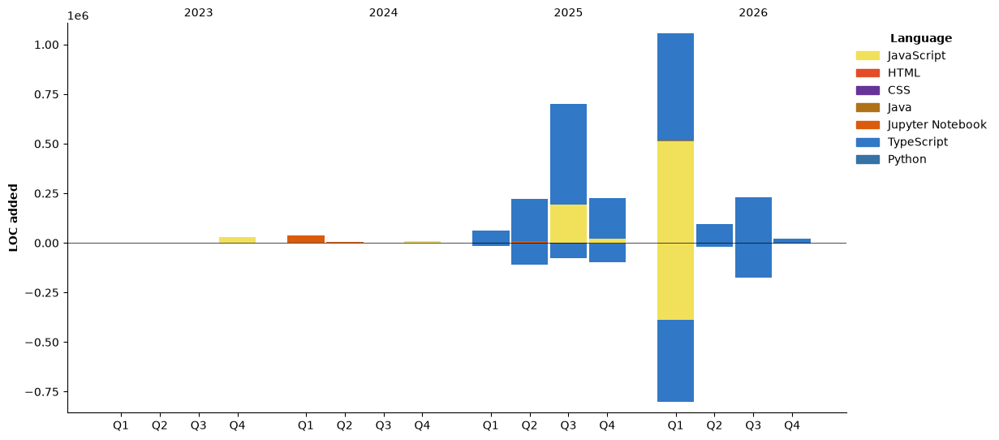

## Hi there, I'm Bhargav Raghuram 👋

- I build on the web, love solving problems, and care about great UX
- Always learning, always shipping

```js
const bhargav = {
  pronouns: "He" | "Him",
  code: ["JavaScript", "TypeScript", "Node.js", "React", "MongoDB",
  "Electron.js","Flask","Python"],
  expertise: ["Web Dev", "Cross Platform Desktop Apps", "UI/UX"],
  currentFocus: "Creating useful, delightful software",
};
```

---

### ⏱️ Code Time & Weekly Breakdown
<!--START_SECTION:waka-->


**🐱 My GitHub Data** 

> 📦 ? Used in GitHub's Storage 
 > 
> 🏆 263 Contributions in the Year 2026
 > 
> 💼 Opted to Hire
 > 
> 📜 30 Public Repositories 
 > 
> 🔑 0 Private Repositories 
 > 
**I'm an Early 🐤** 

<svg width="720" viewBox="0 0 720 116" xmlns="http://www.w3.org/2000/svg"><text x="0" y="16" font-family="monospace" font-size="13" fill="#c9d1d9">🌞 Morning</text><text x="170" y="16" font-family="monospace" font-size="13" fill="#8b949e">466 commits</text><rect x="280" y="6" width="360" height="8" rx="4" fill="#161b22"/><rect x="280" y="6" width="37" height="8" rx="4" fill="#58a6ff"/><text x="648" y="16" font-family="monospace" font-size="12" fill="#8b949e">10.33%</text><text x="0" y="40" font-family="monospace" font-size="13" fill="#c9d1d9">🌆 Daytime</text><text x="170" y="40" font-family="monospace" font-size="13" fill="#8b949e">2142 commits</text><rect x="280" y="30" width="360" height="8" rx="4" fill="#161b22"/><rect x="280" y="30" width="171" height="8" rx="4" fill="#58a6ff"/><text x="648" y="40" font-family="monospace" font-size="12" fill="#8b949e">47.47%</text><text x="0" y="64" font-family="monospace" font-size="13" fill="#c9d1d9">🌃 Evening</text><text x="170" y="64" font-family="monospace" font-size="13" fill="#8b949e">1854 commits</text><rect x="280" y="54" width="360" height="8" rx="4" fill="#161b22"/><rect x="280" y="54" width="148" height="8" rx="4" fill="#58a6ff"/><text x="648" y="64" font-family="monospace" font-size="12" fill="#8b949e">41.09%</text><text x="0" y="88" font-family="monospace" font-size="13" fill="#c9d1d9">🌙 Night</text><text x="170" y="88" font-family="monospace" font-size="13" fill="#8b949e">50 commits</text><rect x="280" y="78" width="360" height="8" rx="4" fill="#161b22"/><rect x="280" y="78" width="4" height="8" rx="4" fill="#58a6ff"/><text x="648" y="88" font-family="monospace" font-size="12" fill="#8b949e">1.11%</text></svg>
📅 **I'm Most Productive on Monday** 

<svg width="720" viewBox="0 0 720 188" xmlns="http://www.w3.org/2000/svg"><text x="0" y="16" font-family="monospace" font-size="13" fill="#c9d1d9">Monday</text><text x="170" y="16" font-family="monospace" font-size="13" fill="#8b949e">982 commits</text><rect x="280" y="6" width="360" height="8" rx="4" fill="#161b22"/><rect x="280" y="6" width="78" height="8" rx="4" fill="#58a6ff"/><text x="648" y="16" font-family="monospace" font-size="12" fill="#8b949e">21.76%</text><text x="0" y="40" font-family="monospace" font-size="13" fill="#c9d1d9">Tuesday</text><text x="170" y="40" font-family="monospace" font-size="13" fill="#8b949e">810 commits</text><rect x="280" y="30" width="360" height="8" rx="4" fill="#161b22"/><rect x="280" y="30" width="65" height="8" rx="4" fill="#58a6ff"/><text x="648" y="40" font-family="monospace" font-size="12" fill="#8b949e">17.95%</text><text x="0" y="64" font-family="monospace" font-size="13" fill="#c9d1d9">Wednesday</text><text x="170" y="64" font-family="monospace" font-size="13" fill="#8b949e">749 commits</text><rect x="280" y="54" width="360" height="8" rx="4" fill="#161b22"/><rect x="280" y="54" width="60" height="8" rx="4" fill="#58a6ff"/><text x="648" y="64" font-family="monospace" font-size="12" fill="#8b949e">16.60%</text><text x="0" y="88" font-family="monospace" font-size="13" fill="#c9d1d9">Thursday</text><text x="170" y="88" font-family="monospace" font-size="13" fill="#8b949e">500 commits</text><rect x="280" y="78" width="360" height="8" rx="4" fill="#161b22"/><rect x="280" y="78" width="40" height="8" rx="4" fill="#58a6ff"/><text x="648" y="88" font-family="monospace" font-size="12" fill="#8b949e">11.08%</text><text x="0" y="112" font-family="monospace" font-size="13" fill="#c9d1d9">Friday</text><text x="170" y="112" font-family="monospace" font-size="13" fill="#8b949e">750 commits</text><rect x="280" y="102" width="360" height="8" rx="4" fill="#161b22"/><rect x="280" y="102" width="60" height="8" rx="4" fill="#58a6ff"/><text x="648" y="112" font-family="monospace" font-size="12" fill="#8b949e">16.62%</text><text x="0" y="136" font-family="monospace" font-size="13" fill="#c9d1d9">Saturday</text><text x="170" y="136" font-family="monospace" font-size="13" fill="#8b949e">410 commits</text><rect x="280" y="126" width="360" height="8" rx="4" fill="#161b22"/><rect x="280" y="126" width="33" height="8" rx="4" fill="#58a6ff"/><text x="648" y="136" font-family="monospace" font-size="12" fill="#8b949e">9.09%</text><text x="0" y="160" font-family="monospace" font-size="13" fill="#c9d1d9">Sunday</text><text x="170" y="160" font-family="monospace" font-size="13" fill="#8b949e">311 commits</text><rect x="280" y="150" width="360" height="8" rx="4" fill="#161b22"/><rect x="280" y="150" width="25" height="8" rx="4" fill="#58a6ff"/><text x="648" y="160" font-family="monospace" font-size="12" fill="#8b949e">6.89%</text></svg>


📊 **This Week I Spent My Time On** 

🕑︎ Time Zone: Asia/Kolkata

💬 Programming Languages: 
No Activity Tracked This Week

🔥 Editors: 
No Activity Tracked This Week


🤖 **AI Coding This Week** 

```text
No AI Coding Activity Tracked This Week
```

**I Mostly Code in Java** 

<svg width="720" viewBox="0 0 720 140" xmlns="http://www.w3.org/2000/svg"><text x="0" y="16" font-family="monospace" font-size="13" fill="#c9d1d9">Java</text><text x="170" y="16" font-family="monospace" font-size="13" fill="#8b949e">8 repos</text><rect x="280" y="6" width="360" height="8" rx="4" fill="#161b22"/><rect x="280" y="6" width="78" height="8" rx="4" fill="#58a6ff"/><text x="648" y="16" font-family="monospace" font-size="12" fill="#8b949e">21.62%</text><text x="0" y="40" font-family="monospace" font-size="13" fill="#c9d1d9">TypeScript</text><text x="170" y="40" font-family="monospace" font-size="13" fill="#8b949e">7 repos</text><rect x="280" y="30" width="360" height="8" rx="4" fill="#161b22"/><rect x="280" y="30" width="68" height="8" rx="4" fill="#58a6ff"/><text x="648" y="40" font-family="monospace" font-size="12" fill="#8b949e">18.92%</text><text x="0" y="64" font-family="monospace" font-size="13" fill="#c9d1d9">Jupyter Notebook</text><text x="170" y="64" font-family="monospace" font-size="13" fill="#8b949e">7 repos</text><rect x="280" y="54" width="360" height="8" rx="4" fill="#161b22"/><rect x="280" y="54" width="68" height="8" rx="4" fill="#58a6ff"/><text x="648" y="64" font-family="monospace" font-size="12" fill="#8b949e">18.92%</text><text x="0" y="88" font-family="monospace" font-size="13" fill="#c9d1d9">JavaScript</text><text x="170" y="88" font-family="monospace" font-size="13" fill="#8b949e">7 repos</text><rect x="280" y="78" width="360" height="8" rx="4" fill="#161b22"/><rect x="280" y="78" width="68" height="8" rx="4" fill="#58a6ff"/><text x="648" y="88" font-family="monospace" font-size="12" fill="#8b949e">18.92%</text><text x="0" y="112" font-family="monospace" font-size="13" fill="#c9d1d9">Rust</text><text x="170" y="112" font-family="monospace" font-size="13" fill="#8b949e">1 repo</text><rect x="280" y="102" width="360" height="8" rx="4" fill="#161b22"/><rect x="280" y="102" width="10" height="8" rx="4" fill="#58a6ff"/><text x="648" y="112" font-family="monospace" font-size="12" fill="#8b949e">2.70%</text></svg>


**Timeline**




 Last Updated on 23/11/2026 18:01:23 UTC
<!--END_SECTION:waka-->

---

### 📊 GitHub Stats & Goodies


[](https://github.com/anuraghazra/github-readme-stats)

[](https://github.com/DenverCoder1/github-readme-streak-stats)

[](https://github.com/ryo-ma/github-profile-trophy)

---

### 📫 Connect
- Gmail: bhargavraghuram@gmail.com

---


