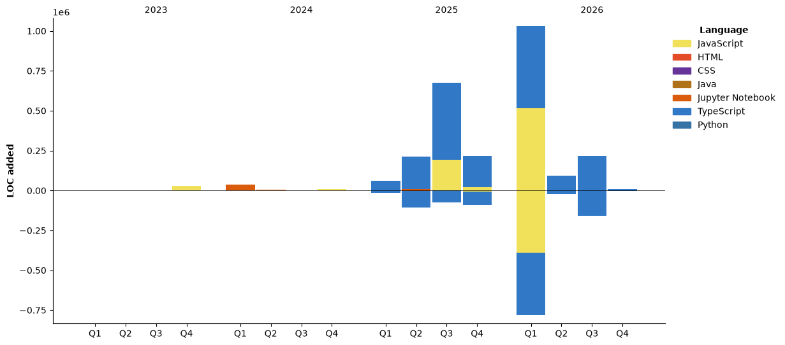

## Hi there, I'm Bhargav Raghuram 👋

- I build on the web, love solving problems, and care about great UX
- Always learning, always shipping

```js
const bhargav = {
  pronouns: "He" | "Him",
  code: ["JavaScript", "TypeScript", "Node.js", "React", "MongoDB",
  "Electron.js","Flask","Python"],
  expertise: ["Web Dev", "Cross Platform Desktop Apps", "UI/UX"],
  currentFocus: "Creating useful, delightful software",
};
```

---

### ⏱️ Code Time & Weekly Breakdown
<!--START_SECTION:waka-->


**🐱 My GitHub Data** 

> 📦 ? Used in GitHub's Storage 
 > 
> 🏆 244 Contributions in the Year 2026
 > 
> 💼 Opted to Hire
 > 
> 📜 30 Public Repositories 
 > 
> 🔑 0 Private Repositories 
 > 
**I'm an Early 🐤** 

```text
🌞 Morning                447 commits         ███░░░░░░░░░░░░░░░░░░░░░░   10.34 % 
🌆 Daytime                2059 commits        ████████████░░░░░░░░░░░░░   47.62 % 
🌃 Evening                1773 commits        ██████████░░░░░░░░░░░░░░░   41.00 % 
🌙 Night                  45 commits          ░░░░░░░░░░░░░░░░░░░░░░░░░   01.04 % 
```
📅 **I'm Most Productive on Monday** 

```text
Monday                   942 commits         █████░░░░░░░░░░░░░░░░░░░░   21.79 % 
Tuesday                  773 commits         ████░░░░░░░░░░░░░░░░░░░░░   17.88 % 
Wednesday                714 commits         ████░░░░░░░░░░░░░░░░░░░░░   16.51 % 
Thursday                 481 commits         ███░░░░░░░░░░░░░░░░░░░░░░   11.12 % 
Friday                   719 commits         ████░░░░░░░░░░░░░░░░░░░░░   16.63 % 
Saturday                 399 commits         ██░░░░░░░░░░░░░░░░░░░░░░░   09.23 % 
Sunday                   296 commits         ██░░░░░░░░░░░░░░░░░░░░░░░   06.85 % 
```


📊 **This Week I Spent My Time On** 

```text
🕑︎ Time Zone: Asia/Kolkata

💬 Programming Languages: 
No Activity Tracked This Week

🔥 Editors: 
No Activity Tracked This Week

💻 Operating System: 
No Activity Tracked This Week
```

🤖 **AI Coding This Week** 

```text
No AI Coding Activity Tracked This Week
```

**I Mostly Code in Java** 

```text
Java                     8 repos             ██████░░░░░░░░░░░░░░░░░░░   22.22 % 
TypeScript               7 repos             █████░░░░░░░░░░░░░░░░░░░░   19.44 % 
Jupyter Notebook         7 repos             █████░░░░░░░░░░░░░░░░░░░░   19.44 % 
JavaScript               7 repos             █████░░░░░░░░░░░░░░░░░░░░   19.44 % 
Rust                     1 repo              █░░░░░░░░░░░░░░░░░░░░░░░░   02.78 % 
```


**Timeline**




 Last Updated on 01/11/2026 03:47:52 UTC
<!--END_SECTION:waka-->

---

### 📊 GitHub Stats & Goodies


[](https://github.com/anuraghazra/github-readme-stats)

[](https://github.com/DenverCoder1/github-readme-streak-stats)

[](https://github.com/ryo-ma/github-profile-trophy)

---

### 📫 Connect
- Gmail: bhargavraghuram@gmail.com

---


